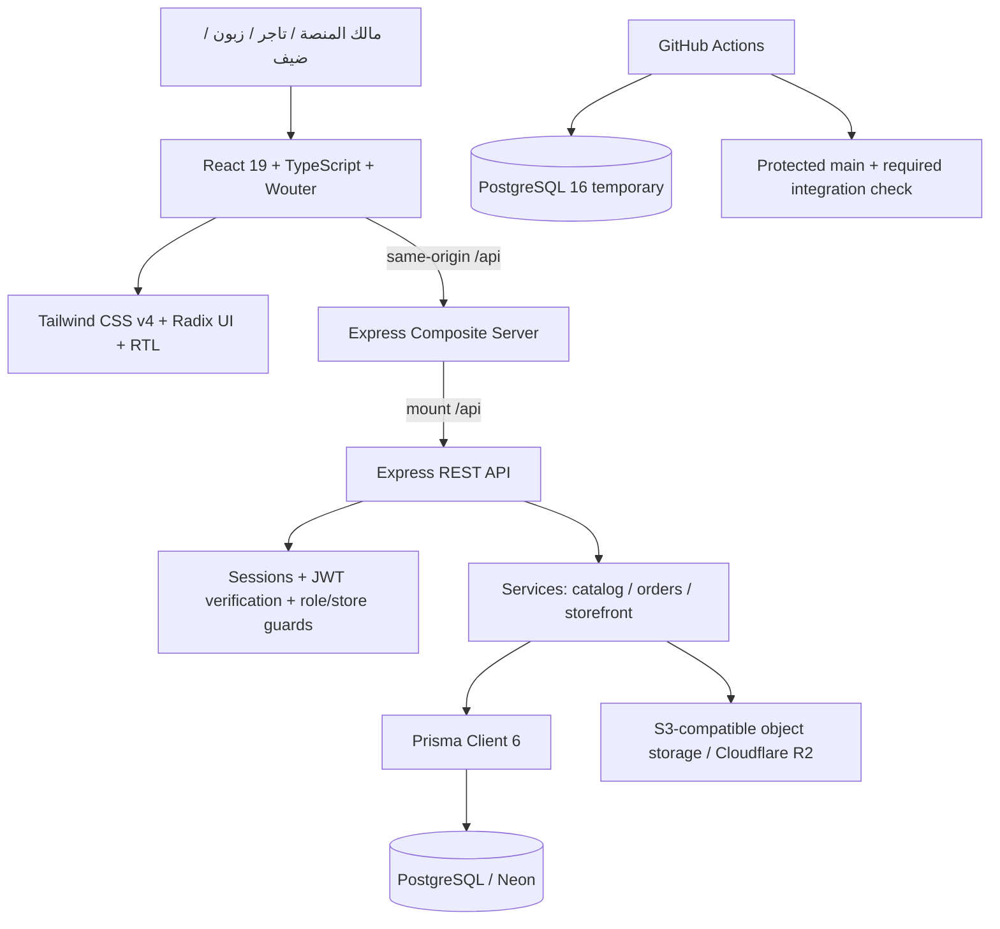

# تحليل تقني للمراحل المتقدمة 12–26 — منصة CODIQ

**نوع الوثيقة:** تحليل معماري وتخطيطي فقط؛ لا يشكل موافقة على تنفيذ أي مرحلة أو تعديل تشغيلي.  
**حالة المصدر:** مبني حصراً على خطة CODIQ الرسمية، وثيقة SRS، وملفات التطبيق الفعلية المتاحة في المستودع.  
**تاريخ الإعداد:** 21 أغسطس 2026.  
**المرجع المرحلي:** المراحل 1–11A منجزة، بينما 11B محجوبة إلى أن تتأكد بيئة Railway staging المنفصلة وPublic Domain الخاص بها. [1] [2]

> **الخلاصة التنفيذية:** أصعب ما في CODIQ ليس إضافة صفحة أو endpoint منفرد، بل الحفاظ على العزل متعدد المستأجرين، وسلامة المعاملات، وأثر كل قرار جديد على طبقات الأمن والتشغيل. النموذج الحالي قوي في تلك الأسس: `store_id`، علاقات مركبة، جلسات منفصلة، معاملات `Serializable`، وأقفال صفوف في checkout. المراحل 12–17 ستضيف تعقيد الأعمال والهوية والقيود المالية؛ أما 18–26 فستختبر قابلية النظام للتوسع والتشغيل والأمان والتكامل الخارجي.

---

## 1. حدود التحليل وحالة الخطة

يعرض هذا التحليل التحديات **المتوقعة**، لا أعطالاً مثبتة. أي بند موسوم «متوقع» هو استنتاج هندسي قائم على نطاق المرحلة والبنية الحالية، وليس دليلاً على وجود عيب في الإنتاج. أما الوقائع عن الحالة أو المعمارية الحالية فموثقة بالمراجع الداخلية في نهاية التقرير.

هناك عدم تطابق زمني يجب التعامل معه بوضوح: الخطة الرسمية v2 تسمي المرحلة 12 «واجهة Storefront وحساب الزبون (9B)»، في حين أن تنفيذ 9B موجود فعلياً ومختبر وفق وثيقة SRS. لذلك لا ينبغي إعادة بناء Storefront في المرحلة 12؛ بل ينبغي أن تبدأ بمراجعة فجوة رسمية بين متطلبات المرحلة 12 الأصلية وما هو منفذ، ثم يقتصر نطاقها على إغلاق فجوات مثبتة أو تعزيزات تعتمدها المراجعة. [1] [2]

| منطقة العمل | الحالة الحالية | الأثر على المراحل المتقدمة |
|---|---|---|
| النشر المرحلي | 11B غير مكتملة؛ لا يوجد staging منفصل مؤكد بعد. | يمنع اعتماد أي تدفقات مستقبلية تتطلب تحققاً خارج البيئة المحلية وCI. |
| عزل المستأجرين | منفذ في الخادم وقاعدة البيانات عبر `store_id` وقيود مركبة واختبارات IDOR. | كل جدول أو endpoint أو job أو ملف جديد يجب أن يحمل سياق المتجر ولا يسمح بتجاوزه. |
| Storefront وCOD | موجودان، بما فيهما السلة والحجز والـidempotency ورسوم التوصيل. | المرحلة 12 يجب أن تعالج الفجوات فقط وتحمي معاملات checkout القائمة. |
| CI | تكامل حاجب على PostgreSQL مؤقت؛ اختبارات المتصفح ظاهرة لكنها غير حاجبة. | يلزم تثبيت اختبارات المتصفح قبل ادعاء جاهزية E2E أو إنتاجية عالمية. |
| المعمارية التشغيلية | خادم Express مركب وNeon/R2 قابلان للنقل؛ Railway قيد التثبيت. | مراحل jobs والمراقبة والدفع تحتاج طبقة تشغيل واضحة لا تعتمد على عملية ويب عابرة. |

---

## 2. المعمارية الحالية كما يصفها الكود والوثائق

### 2.1 الطبقات ومسار الطلب

يعتمد النظام نموذج ويب تقليدي قابل للنقل: متصفح React يرسل طلبات same-origin إلى REST API تحت `/api`، ويقوم خادم Express مركب بتركيب API من `phase1-backend` وتقديم ملفات الـSPA المبنية. لا يوجد اعتماد وظيفي على tRPC أو OAuth أو StorageProxy الخاص بالقالب. [2] [5]

| الطبقة | التكنولوجيا الفعلية | المسؤولية المعمارية | نقطة الحذر المستقبلية |
|---|---|---|---|
| الواجهة | React 19، TypeScript، Vite 7، Wouter، Tailwind v4، Radix UI. [4] | واجهات المالك والتاجر والـStorefront العربي. | تنظيم المكونات وtheme وi18n وSEO بدون تسريب منطق الأعمال إلى المتصفح. |
| دخول التطبيق | Node.js + Express 4 + `http.createServer`. [4] [5] | تركيب API عند `/api` وتقديم SPA من `dist/public`. | تطور مسار واحد من middleware إلى طبقات صريحة للصلاحيات وversioning وobservability. |
| API | REST Express في `phase1-backend/src/http/app.ts`. [6] | المصادقة، التفويض، السلة، checkout، الكتالوج والطلبات. | عدم تحويل منطق endpoint المتكرر إلى نقاط فحص غير متسقة مع إدخال staff وAPI v1. |
| المجال | خدمات TypeScript مفصولة نسبياً. | منطق checkout، المخزون، السلات، دورة الطلبات والكتالوج. | إبقاء قواعد الأعمال المشتركة في service واحدة بدلاً من تكرارها في jobs أو webhooks. |
| البيانات | PostgreSQL + Prisma 6. [4] [7] | عزل tenant، العلاقات، الفهارس، المعاملات والقيود. | الترحيلات additive-first، وفهارس تستجيب لنمو البيانات والبحث والتقارير. |
| الملفات | AWS SDK S3-compatible، مع R2 موثق كمزود صور. [2] [4] | حفظ `object_key` وmetadata؛ لا تخزين bytes في DB. | روابط موقعة، عزل المفاتيح حسب المتجر، وسياسات حذف/استعادة. |
| التغيير | GitHub Actions + PostgreSQL 16 مؤقت + حماية `main`. [2] | typecheck وbuild وmigrations واختبارات التكامل قبل الدمج. | جعل browser CI مستقراً وحاجباً لاحقاً، وربط staging الحقيقية. |

### 2.2 نموذج الهوية والتفويض

توجد ثلاثة أنواع هوية منفصلة: مالك منصة، تاجر، وزبون. يحتفظ كل نوع بجلساته الخاصة، في حين أن جلسة التاجر مرتبطة أيضاً بمتجر واحد. تحل دوال الحراسة في API المتجر من `slug` ثم تتحقق من نوع الجلسة والملكية وحدود `store_id` على الخادم؛ لذا لا تعتمد الحماية على إخفاء عناصر الواجهة. [2] [6] [7]

| الهوية | حد الصلاحية الحالي | الآلية الفعلية | تحدي التوسع |
|---|---|---|---|
| مالك المنصة | عالمي ومصرح به. | `requirePlatformOwner` مع جلسة مالك مستقلة. | المحافظة على الفصل بين قدرة الإشراف العالمي وأي قدرة مالية أو إدارية مستقبلاً. |
| التاجر | متجر واحد لكل جلسة. | `merchant_sessions.store_id` و`requireMerchantStore`. | Store switcher والـstaff يجب أن يصدران/يفسران السياق دون جعله قابلاً للتزوير. |
| الزبون | متجر واحد. | تحقق من `customerId + storeId` وCookie scoped لمسار Storefront. | الحساب عبر عدة متاجر ليس افتراضاً حالياً؛ يجب عدم دمجه عرضاً في i18n أو SSO أو التسويق. |
| ضيف Storefront | سلة لمتجر واحد. | token عشوائي مُبصم وCookie HttpOnly محدد لمسار `/api/store/:slug`. | تلافي تسريب cookie أو دمج سلات متنافس في مرحلة الأداء أو النطاقات. |

### 2.3 طبقة البيانات: العزل والسلامة قبل الأداء

يضع المخطط `store_id` على الكيانات المتجرية الرئيسة، ويستخدم مفاتيح فريدة وعلاقات مركبة مثل `[id, storeId]` عبر الطلبات والسلات والعناوين والحجوزات. هذا التصميم يمنع الخلط العرضي في قاعدة البيانات ويجبر الاستعلامات الجديدة على حمل سياق المتجر. كما أن سجل حالات الطلب مصمم append-only وتوجد حجوزات مخزون منفصلة عن الكمية الفعلية للمنتج. [2] [7]

يتخذ checkout مساراً محافظاً: يُنشئ أو يعيد طلب idempotency، يتحقق من نسخة السلة، يقرأ عنوان العميل وسعر التوصيل في المعاملة نفسها، يقفل المنتجات بـ`FOR UPDATE`، يحسب المخزون المتاح بعد الحجوزات، ثم ينشئ الطلب والحجوزات ويحوّل السلة ضمن معاملة `Serializable` مع إعادة محاولة محدودة للتعارضات. [6] [8]

> **الأثر الهندسي:** هذه الضمانات ليست تفصيلاً محلياً في checkout. أي مرحلة تضيف دفعاً أو شحناً أو تسوية أو job أو تعديل حالة طلب يجب أن تلتزم بالتسلسل نفسه، وإلا أمكن أن يحدث تكرار مالي أو تحرر حجز في غير موضعه أو كسر لعزل متجر.

---

## 3. التقنيات الأبرز ولماذا اختيرت

| التقنية | موضع استخدامها | القيمة الحالية | قيد أو عمل مستقبلي مطلوب |
|---|---|---|---|
| PostgreSQL | قاعدة البيانات الموحدة. [7] | معاملات، أقفال صفوف، فهارس، قيود وعلاقات مركبة. | مراقبة خطط الاستعلام، فهارس البحث، النسخ والاستعادة، وعزل البيانات عند الحجم الكبير. |
| Prisma 6 | طبقة ORM والهجرات. [4] [7] | type safety وتوحيد الوصول للبيانات. | بعض مسارات القفل/الأداء تحتاج SQL مقيداً ومدروساً؛ توليد العميل مطلوب في النشر عبر `postinstall`. |
| Express 4 | REST API والخادم المركب. [4] [5] | بسيط ومحمول ولا يفرض مزوداً. | تنظيم middleware، versioning، error contract، telemetry، وRBAC المركزي مع نمو المسارات. |
| React 19 + Vite 7 | واجهة SPA. [4] | سرعة تطوير، TypeScript، وبناء مناسب للوحة وStorefront. | bundle تحذيري فوق 500kB موثق؛ يلزم lazy loading وقياس أداء حقيقي في 21–23. [2] |
| Tailwind CSS v4 + Radix UI | نظام الواجهة. [4] | tokens/utilities ومكونات قابلة للوصول نسبياً. | التحول إلى Design System شامل، ثم theme لكل متجر دون CSS عشوائي. |
| Wouter | توجيه الواجهة. [4] | خفيف ومناسب لـSPA الحالية. | navigation مركزي وguards عرضية لا تحل محل الخادم؛ مسارات النطاقات وSEO قد تحتاج هندسة عرض إضافية. |
| JWT + Sessions مخزنة | مصادقة الأنواع الثلاثة. [6] [7] | صلاحية قصيرة، إلغاء عبر `revoked_at`، Cookies HttpOnly. | إدارة أجهزة وجلسات متعددة، reset password، وتخفيف fixation/brute force في 19. |
| S3-compatible + AWS SDK | صور المنتجات. [4] | قابلية نقل بين R2 أو مزود S3 آخر. | presigned URLs، metadata validation، lifecycle، واستعادة الملفات في 19 و24. |
| GitHub Actions | بوابة تكامل. [2] | قاعدة PostgreSQL مؤقتة ولا أسرار Neon في CI. | E2E غير حاجب حالياً؛ مراقبة artifacts ومصداقية staging ما زالت غير مكتملة. |
| Railway + Neon + R2 | طبقة التشغيل الموثقة. [1] [2] | فصل app/database/storage بصورة مبدئية. | staging الحقيقية، أسرار منفصلة، health checks، restore، والمراقبة قبل اعتماد إنتاج واسع. |

---

## 4. مصفوفة التحديات التقنية حسب المرحلة

### 4.1 المراحل 12–17: إكمال المنتج التجاري

| المرحلة | جوهرها وفق الخطة | التحدي التقني الأهم | سبب الصعوبة في CODIQ | ضوابط/مخرجات ينبغي طلبها قبل الإغلاق |
|---:|---|---|---|---|
| 12 | تعزيز واجهة Storefront وحساب الزبون. | **مواءمة الخطة مع الواقع ومنع إعادة التنفيذ.** | نطاق 12 الأصلي نُفذ بدرجة كبيرة في 9B؛ خطرها أن يصبح refactor غير محدد أو تكرار API قائم. | Gap analysis موثق، acceptance scenarios معتمدة، اختبار متجرين و390px، وحماية checkout القائم. |
| 13 | Store switcher وإنشاء متجر جديد. | **إدارة سياق التاجر كحد أمني.** | الجلسة الحالية = متجر واحد؛ تبديل المتجر لا يجوز أن يوسع الجلسة القديمة أو يتيح slug مملوكاً لتاجر آخر. | endpoint يصدر جلسة جديدة مقيدة، 403 عند متجر غير مملوك، slug validation على الخادم، حد متاجر مؤقت مع اختبارات. |
| 14 | Staff وRBAC granular وnavigation مركزي. | **إعادة بناء التفويض حول permissions من دون كسر الأدوار الحالية.** | كل endpoint حساس قائم يعتمد نوع الهوية/تاجر؛ إدخال membership وصلاحيات يحتاج retrofit كامل لا صفحة إدارة فقط. | ADR مستقل للـstaff، permission matrix، middleware/resolver واحد، اختبارات موجب/سالب لكل permission وIDOR regression. |
| 15 | Outbox وإشعارات. | **ضمان exactly-once منطقياً وسط at-least-once عملياً.** | كتابة event يجب أن تكون ذرية مع الطلب، لكن مزود SMS/email غير ذري؛ retries قد تكرر الإرسال. | notification outbox transactional، idempotency/provider message key، worker منفصل، exponential backoff وdead letter، اختبار rollback/retry. |
| 16 | خطط واشتراكات وFeature Gating. | **فرض الحدود على الخادم وبلا حالات سباق.** | حد المنتجات أو الموظفين أو المتاجر قد يُخترق بطلبين متزامنين إن كان check ثم insert منفصلين. | entitlement service موحدة، عدادات/استعلامات مقفلة أو constraints مناسبة، Free backfill قابل للإرجاع، اختبارات API مباشرة وتزامن. |
| 17 | تسويات وعمولات ونطاقات وتسجيل ذاتي. | **دقة دفتر مالي غير قابل للتعديل + دقة حل النطاق إلى tenant.** | حالة order والمرتجع والحجز موجودة بالفعل؛ القيود المالية يجب ألا تتكرر أو تتبدل، والنطاق لا يجوز أن يوجه لمتجر خاطئ. | ledger append-only وTrigger، سيناريوهات عودة داخل/خارج النافذة، settlement immutable، Host→store tests، DNS/TLS runbook. |

#### المرحلة 12 — Storefront: خطر «التنفيذ مرتين» قبل خطر الواجهة

الواجهة المطلوبة في الخطة تشمل الكتالوج والسلة وCOD والحساب والعناوين وRTL والجوال، لكنها موجودة وظيفياً في 9B وفق SRS. التحدي الأكثر أهمية هو تحويل المرحلة إلى **مراجعة فجوة قابلة للقياس**: هل ما يزال search أو تصفية التصنيفات أو صفحة نجاح الطلب أو ناتج SEO الأساسي ناقصاً؟ لا تُفتح أي فجوة بمجرد التخمين؛ يجب ربطها بسيناريو قبول أو عقد API أو عيب موثق. [1] [2]

من الناحية التقنية، يجب ألا تُمس ضمانات checkout: نسخة السلة، المفتاح idempotency، قفل المنتجات قبل فحص التوفر، التسعير الملتقط، والسياق `store_id`. أي تحسين بصري في السلة يحتاج التعامل الصحيح مع `409 CART_VERSION_CONFLICT` و`422 INSUFFICIENT_AVAILABLE_STOCK` بدلاً من إخفائها أو إعادة المحاولة بصمت. [6] [8]

#### المرحلة 13 — Store switcher: تبديل السياق لا تفويض شامل

التصميم المخطط صحيح: تستقبل الجلسة السليمة وslug لمتجر يملكه التاجر، ثم تصدر جلسة جديدة مقيدة بالمتجر المحدد مع بقاء الجلسة القديمة في سياقها. الخطر هو بناء جلسة تاجر تحمل قائمة متاجر أو scope واسعاً ثم الاعتماد على الواجهة لاختيار المتجر؛ ذلك يبدل الحاجز الحالي من قاعدة «جلسة = متجر» إلى «مسار يحدد الصلاحية». [1] [6] [7]

تظهر أيضاً تحديات تشغيلية صغيرة لكن حقيقية: منع تضارب `slug` على PostgreSQL، تعريف حد المتاجر قبل نظام الخطط، تأسيس `delivery_rates` و`payment_methods` و`notification_settings` للمتجر الجديد بصورة ذرية، وتأمين عدم تعطل جداول/واجهات التاجر عند حذف أو تعطيل متجر. هذه المرحلة ينبغي أن تعرف بوضوح معنى store inactive، وتفصل بين إنشائه وتعطيله وأرشفته.

#### المرحلة 14 — Staff/RBAC: أثقل إعادة تأهيل داخلية

هذه غالباً أثقل مراحل القسم بسبب اتساع سطح التفويض، لا بسبب عدد الجداول فقط. النموذج المقترح (هوية staff مستقلة، memberships، permissions، أدوار حزمية وتخصيص per-membership) يحافظ على فلسفة الفصل الحالية، لكنه يفرض قراراً مبكراً حول أثر عضوية الموظف عند تعطيل المتجر أو تبديل الدور أو إبطال كل الجلسات. [1]

المخاطر الرئيسة هي **privilege escalation** عبر permission ناقصة في endpoint قديم، و**التباين بين الواجهة والخادم** إذا أخفت sidebar رابطاً لكن endpoint بقي متاحاً، و**التعارض بين owner/merchant/staff** إذا دُمجت هوية الموظف على نحو يخلط أنواع الجلسات. المعالجة ليست فحصاً يدوياً لمسار واحد، بل resolver مركزي وتعريف policy لكل use case، ثم قائمة تحقق توضح أن كل endpoint للكتالوج والطلبات والزبائن والإعدادات يمر عبر policy المناسبة. [1] [6]

#### المرحلة 15 — Outbox: فصل الحدث عن الإرسال

المطلوب كتابة `notification_outbox` في معاملة الطلب أو الحدث الأصلي، ثم معالج منفصل يرسل ويعيد المحاولة. هذا ينهي مشكلة «تم إنشاء الطلب لكن فشل التنبيه»، لكنه لا يجعل مزود الرسائل transactionally consistent؛ عند timeout قد لا يعرف العامل إن كان المزود قبل الرسالة أم لا. لذلك يجب أن تصمم الرسالة بمعرف idempotency قابل للتتبع، وأن تقبل المنظومة تكراراً آمناً أو تستخدم قدرة deduplication لدى المزود إن كانت متاحة. [1]

هناك أيضاً سؤال تشغيل غير محلول: أين يعمل العامل؟ العملية الويب الحالية قد تكون serverless/autoscaled في الاستضافة، لذلك لا يجوز افتراض `setInterval` داخل خادم Express. يلزم اختيار heartbeat/scheduler أو worker مستقل قابل للنقل، وقياس التزامن وقفل صف outbox كي لا يعالجه عاملان في وقت واحد. قبل التصميم والتنفيذ يجب قراءة سياسة jobs الدورية الخاصة بالمشروع واختيار بيئة تشغيل تناسب عامل الخلفية.

#### المرحلة 16 — الخطط: القيود مصدر حقيقة خادمي

Feature gating لا ينجح إذا كان مجرد badge في لوحة التاجر. المخطط يتطلب `plans` و`plan_features` و`merchant_subscriptions` وentitlement resolver واحداً. التحدي هو تعريف «الاستهلاك» بدقة: هل المنتجات غير النشطة تعد ضمن الحد؟ هل store المعطل يعد؟ ما هو الشهر المرجعي لحد الطلبات؟ وما الذي يحدث عند تخفيض الخطة؟ تلك قواعد أعمال لها أثر مباشر على SQL وواجهات الخطأ والتقارير. [1]

يجب أيضاً حل التزامن؛ ففحص count ثم create قد يسمح لطلبين بتجاوز الحد. قد يلزم lock على الاشتراك/التاجر أو نمذجة عدادات محمية أو isolation مناسب، مع اختبارات منافسة مثل اختبارات checkout الحالية. كما يتطلب backfill للخطة Free أن يكون additive وقابلاً للمراجعة لأن جدول merchants قائم في قاعدة production.

#### المرحلة 17 — التسويات والنطاقات: نظامان حرجان في مرحلة واحدة

يتضمن النطاق سجل قيود مالي append-only للطلبات المكتملة والمرتجعة، وتسويات، ونطاقات مخصصة، وموقعاً تعريفياً وتسجيل تاجر ذاتياً. أقسى تحدي مالي هو تحديد الحدث المالي الوحيد المخول بإنشاء القيد وعلاقته بـ`completed → returned`. ينبغي أن يكون القيد فريداً لكل order/event، وأن يحمي Trigger السجل من التعديل والحذف، وأن تمنع المعاملة أو قيد uniqueness التكرار عند retries. [1] [7]

أما النطاقات فتدخل متغير طلب جديداً: `Host`. يتطلب ذلك resolver آمن يفصل `default_subdomain` و`custom_domain` ولا يسمح بتجاوز اختيار المتجر عبر parameter أو host مزور في بيئة غير موثوقة. كذلك فإن DNS وTLS وإبطال نطاق والتعامل مع cached host لم تعد شؤون واجهة؛ هي runbooks تشغيلية لا يمكن اختبارها فقط بوحدة اختبار محلية.

### 4.2 المراحل 18–26: الجاهزية العالمية والتشغيل الآمن

| المرحلة | جوهرها وفق الخطة | التحدي التقني الأهم | سبب الصعوبة في CODIQ | ضوابط/مخرجات ينبغي طلبها قبل الإغلاق |
|---:|---|---|---|---|
| 18 | تدقيق معماري وسجل دين. | **قياس الواقع لا إعادة تصميمه.** | يضم النظام UI/API/DB/R2/jobs/CI/hosting؛ التدقيق بلا أدلة سينتج قائمة تجميلية. | Master Architecture، debt register بالشدة والأثر والتعقيد، ربط كل بند بملف أو اختبار أو قياس. |
| 19 | أمن وعزل وOWASP/ASVS. | **تحويل الحماية الحالية إلى اختبار هجومي شامل.** | ستتوسع السطوح إلى staff، ملفات، jobs، domains وتقارير، لا APIs الحالية فقط. | attack/defense report، gitleaks history scan، اختبارات XSS/path traversal/brute force/fixation، وعدم وجود Critical مفتوح. |
| 20 | Data/API/OpenAPI/search. | **Versioning وأداء البحث دون تدمير العقود القائمة.** | API قائم بلا `/v1` وتوجد قائمتان cursor-based لكن ليس ضمان موحداً لكل المسارات. | OpenAPI من الكود/العقود، error schema موحدة، pagination متسقة، EXPLAIN/فهرسة، performance data واقعية. |
| 21 | Frontend architecture وDesign System وtheme. | **refactor تدريجي بلا big-bang مع فصل theme عن الأعمال.** | التطبيق SPA قائم والـbundle محذر؛ theme لكل متجر يجب ألا تغير auth/cart/checkout. | feature-by-feature migration، tokens مركزية، visual regression، إثبات theme جديد بتغيير tokens فقط. |
| 22 | i18n/WCAG/SEO. | **RTL/LTR وSEO في SPA متعددة المتاجر.** | النصوص والاتجاهات وحسابات IQD/التاريخ موجودة عبر مسارات متعددة، ومحركات البحث تحتاج strategy مدروسة. | message catalog كامل، اختبارات لغة/اتجاه، accessibility ≥90 للتدفقات الحرجة، metadata/structured data/sitemap/canonical. |
| 23 | الأداء والحمل. | **الحفاظ على تناسق checkout تحت التوازي مع نمو بيانات حقيقي.** | `Serializable` وlocks آمنان لكن قد يرفعان retries والlatency تحت الضغط. | performance budgets، load profiles، p50/p95/p99، عتبة failure، ونتائج checkout المتزامن لا تخمينات. |
| 24 | التشغيل والنسخ والمراقبة. | **إثبات قابلية الاستعادة لا مجرد النسخ.** | app/db/R2/DNS/deploy تفصلها مزودات؛ 11B staging غير مثبتة بعد. | Restore فعلي على branch، RPO/RTO مقاسان، structured logs، alerts، health dashboard، cache/webhook/cleanup runbooks. |
| 25 | دفع/شحن/فواتير. | **التعامل الآمن مع عدم موثوقية الأنظمة الخارجية والمال.** | الدفع والشحن webhooks غير متزامنة، وقد تأتي مكررة أو مرتبة عكسياً؛ لا يمكن الوثوق بحالة المتصفح. | provider abstraction، signature verification، idempotency، ledger للاشتراكات، sandbox E2E، reconciliation ومصالحات فشل. |
| 26 | توثيق وتدقيق نهائي. | **تحويل المعرفة المتفرقة إلى دليل تشغيل قابل للتدقيق.** | الجاهزية لا تثبت بوثيقة واحدة؛ يجب توحيد الأدلة من كل المراحل. | Developer guide، API/DB/permissions/deployment/runbooks، final audit، سجل الاستثناءات المقبولة بقرار المالك. |

#### المرحلة 18 — التدقيق: أكبر خطر هو التقرير غير القابل للتنفيذ

مرحلة 18 يجب أن تؤجل الـrefactor الكبير وتنتج خريطة قرار. التقرير الجيد لا يكتب «تحسين الأداء» أو «تحسين الأمن» بصورة عامة؛ بل يسجل مثلاً: bundle تحذيري، مصدره، أثره المقاس أو المتوقع، البدائل، ترتيب المعالجة، ومرحلة التنفيذ. لدى CODIQ عناصر معروفة يمكن أن تشكل مدخل التدقيق: B-15 لاختبارات المتصفح، staging غير مؤكدة، bundle warning، والتوسعات المتوقعة للـRBAC والـjobs. [2]

#### المرحلة 19 — الأمن: الانتقال من قيود إيجابية إلى محاكاة هجوم

يمتلك النظام حالياً ضوابط مهمة: Cookies HttpOnly scoped، trusted origin للكتابة، rate limiting Storefront، فحص server-side للملكية، وقيود قاعدة بيانات. المرحلة 19 ينبغي أن تتحقق من الحدود التي لم تختبر بعد في سياق النظام الموسع: XSS مخزن في اسم منتج أو ملاحظات، مسارات تخزين/R2، fixed session token، rate-limit bypass عبر headers، وCORS المتصل بالنطاقات المخصصة. [2] [6]

لن تكون security headers وحدها كافية. يلزم اختبار فعلي قبل/بعد لكل سيناريو، وإجراء فحص secrets على **تاريخ** Git لا الشجرة الحالية فقط. كما يجب ألا يسبب إدخال reset password أو phone/email verification خرقاً للقيود الصريحة السابقة إلا بموافقة جديدة محددة؛ هذه قدرات أمان مستقبلية في الخطة وليست مفعلّة حالياً. [1]

#### المرحلة 20 — البيانات وAPI: التوحيد تحت ضغط التوافق العكسي

يتطلب الانتقال إلى `/api/v1` قرار توافق صريح. المسارات القائمة تحت `/api/store/:slug` تستخدمها الواجهة الحالية؛ تغييرها مباشرة سيكسر SPA واختبارات المتصفح. المسار الآمن عادة هو إصدار v1 متوافق/موازٍ أو خطة انتقال موثقة ثم إزالة على مراحل مع اختبارات contract، لا إعادة تسمية سريعة. [1] [6]

البحث باستخدام `pg_trgm` أو `tsvector` مناسب لمسار PostgreSQL القابل للنقل، لكن نجاحه يعتمد على لغة البحث، normalization العربي، نوع queries، والفهارس المناسبة للبيانات الفعلية. يجب توليد بيانات حجم واقعي، تشغيل `EXPLAIN (ANALYZE, BUFFERS)`، ثم توثيق سبب كل فهرس؛ لا يكفي إنشاء فهارس عامة لأنها تضيف تكلفة كتابة ومساحة.

#### المرحلة 21 — Design System: تحسين البنية دون كسر المنتج

التحدي ليس إنشاء Button جديد، بل نقل الواجهة تدريجياً إلى tokens ومكتبة مكونات دون تجميد التطوير أو تغيير سلوك checkout/طلب. يتطلب theme المتجر فصل الهوية البصرية (لون، شعار، غلاف، spacing) عن الآلات الوظيفية (auth، cart، prices، stock). معيار الخطة صحيح: تغيير theme كامل عبر tokens فقط من دون لمس business logic. [1]

كما أن التحذير الحالي لحجم bundle يتطلب قياساً قبل وبعد. قد تتضمن المعالجة lazy routes أو code-splitting أو تحميل صور متجاوب، لكن لا يجوز ادعاء تحسن الأداء لمجرد إعادة تنظيم الملفات. ترتبط هذه المرحلة بالمرحلة 22 لأن استخراج النصوص وتجربة RTL/LTR سيكونان أصعب بعد إعادة بناء عشوائية للـCSS.

#### المرحلة 22 — العالمية: اللغة والإتاحة والبحث ليست طبقة ترجمة

تحتاج i18n إلى استخراج النصوص، تكوين plurals، تنسيق العملة والأرقام والتواريخ، وبدل الاتجاه ديناميكياً. في منصة عراقية عربية الأساس، يجب اختبار الأرقام العربية/اللاتينية، اتجاه عناصر النموذج، وعرض العملة، إلى جانب النص الإنجليزي الكامل. أما WCAG فتحتاج اختبار keyboard focus، modal/drawer behavior، ARIA names، contrast، ورسائل الخطأ في checkout والدخول وإدارة الطلبات، لا نتيجة Lighthouse معزولة. [1]

SEO في SPA متعددة المتاجر يستلزم أيضاً قراراً معمارياً حول rendering: metadata وsitemap وstructured data يمكن إنتاجها، لكن ظهورها للزواحف لا ينبغي افتراضه من DOM عابر فقط. يجب تعريف canonical based on resolved host، سياسة noindex للتاجر، وعدم تسريب بيانات متجر إلى sitemap متجر آخر.

#### المرحلة 23 — الأداء والحمل: التناسق تحت الضغط أهم من throughput المجرد

أكثر سيناريو خطر هو checkout متزامن على منتج محدود المخزون. حالياً تستخدم المنظومة `Serializable` و`FOR UPDATE` وحجوزات مستقلة مع retries. هذا يحمي من overselling، لكنه قد يزيد الانتظار أو إعادة المحاولة مع الحمل. لذلك يجب أن يقاس النجاح على محورين: **صحة النتيجة** (نجاح/رفض صحيحان بلا طلبات أو حجوزات مكررة) و**زمنها** (p50/p95/p99 ومعدل retries/409/5xx). [2] [8]

لا ينبغي أن يبدأ اختبار 10,000 تاجر مباشرة. يبدأ ملف حمل بخليط واقعي: قراءة كتالوج وصور، عمليات سلة، دخول، checkout، ولوحة تاجر، ثم يرفع التدرج. كما يجب فصل ضغط PostgreSQL عن ضغط R2 وطبقة التطبيق، وإلا لا يعرف الفريق إن كان الاختناق في query أو connection pool أو worker أو نقل الصور.

#### المرحلة 24 — التشغيل: لا تصبح النسخة الاحتياطية ضماناً قبل اختبار الاستعادة

تجمع هذه المرحلة تشغيل النظام: app وNeon وR2 وDNS وCDN ومراقبة وأسرار وwebhooks وcleanup. التحدي الحالي المباشر هو أن staging غير مؤكدة في 11B؛ لذلك يجب حل تلك البوابة قبل الاعتماد على تمارين failure أو deploy في مرحلة 24. [2]

ينبغي أن تحتوي السجلات المنظمة على `request_id` و`store_id` و`identity_kind` دون تسجيل tokens أو بيانات حساسة، ليصبح السؤال «أي تاجر تأثر ولماذا؟» قابلاً للإجابة. كما يجب أن يقاس restore من نسخة إلى فرع معزول بالوقت الفعلي ويحدد RPO/RTO، وأن يختبر أثر فقدان App أو DB أو Storage بشكل منفصل. cleanup للسلات والجلسات والحجوزات المنتهية ينبغي أن يكون idempotent وآمناً، وإلا يمكنه تحرير حجز حي أو حذف جلسة صالحة.

#### المرحلة 25 — الدفع والشحن: حدود الثقة الخارجية

هذه المرحلة تجلب الدفع الإلكتروني والشحن والفوترة بعد أن تتوافر outbox وplans وledger وwebhook infrastructure. أكبر خطأ محتمل هو اعتبار callback من المتصفح أو webhook غير موثق مصدراً للحقيقة. يجب أن يتحقق backend من توقيع المزود، وأن يخزن معرف event خارجي فريداً لمنع التكرار، وأن يعالج webhooks خارج الترتيب دون خفض حالة مالية مكتملة إلى حالة أقدم. [1]

كما أن الدفع والشحن يغيران معنى request idempotency: مفتاح checkout المحلي لا يكفي وحده لمنع خصم خارجي مكرر. يلزم provider-level idempotency key وربط دقيق بين payment attempt والطلب والقيد المالي وحالة الشحنة. جميع هذه الحالات يجب أن تُختبر في sandbox مع فشل شبكة، callback مكرر، توقيع مزيف، وحالة تأخير في الإشعار.

#### المرحلة 26 — التدقيق النهائي: تسليم الأدلة لا التطمينات

لا تدّعي المرحلة 26 أن النظام «جاهز» لمجرد نجاح build أو تقرير واحد. معيارها هو ربط كل مطلب نهائي بدليل: اختبار عزل، health/deploy، نتيجة restore، dashboard مراقبة، أرقام حمل، تقرير أمان، فحص i18n/WCAG، عقود API، دليل تكاملات، وسياسات استثناءات معتمدة. [1]

التحدي التنظيمي هو الحفاظ على هذه الأدلة أثناء المراحل السابقة. لذلك ينبغي أن تنتج كل مرحلة تقريراً قابلاً للإحالة، وأن يحدد تقرير 26 صراحة البنود غير المنفذة أو الاستثناءات المقبولة ومن وافق عليها، بدلاً من دمجها تحت عبارة عامة عن الجاهزية.

---

## 5. المخاطر العابرة للمراحل وأولويات المعالجة

| الأولوية | الخطر العابر | المراحل المتأثرة | أثره إذا لم يعالج | الإجراء الوقائي الصحيح |
|---|---|---|---|---|
| حرجة | عدم وجود staging منفصلة مؤكدة. | 12–26، خصوصاً 17 و19 و24 و25. | تحقق على بيئة غير صحيحة أو خطر لمس production. | إغلاق 11B رسمياً: بيئة معزولة، domain واضح، أسرار staging، health check غير حاجب ثم موثوق. |
| حرجة | توسع RBAC دون retrofit كامل للـAPI القائم. | 14 ثم 16–25. | IDOR أو privilege escalation عبر endpoint قديم. | policy/permission resolver مركزي ومصفوفة اختبار كل endpoint وكل role. |
| حرجة | تكرار الأحداث الخارجية أو الداخلية. | 15 و17 و24 و25. | SMS/email مكرر، قيد مالي مكرر، خصم أو شحنة مكررة. | outbox، idempotency keys، unique event identifiers، append-only ledger وreconciliation. |
| عالية | تراجع checkout تحت الأداء/التكاملات. | 12 و17 و23 و25. | overselling أو أرقام إجمالية/مالية غير متسقة. | لا تعديل على transaction boundaries من دون اختبار تنافسي وسيناريو rollback. |
| عالية | الاعتماد على job داخل عملية الويب. | 15 و24 و25. | retries/cleanup لا تعمل بعد autoscaling أو تعمل مكرراً. | worker/scheduler مستقل موثق وقابل للنقل مع locking ومراقبة. |
| عالية | التوافق العكسي للـAPI. | 14 و20 و25. | كسر SPA أو تكامل مستقبلي عند إصدار v1. | contract tests، deprecation policy، مسار انتقال لا إعادة تسمية مفاجئة. |
| متوسطة | نمو البيانات من دون observability وقياس. | 20 و23 و24. | فهارس خاطئة، p99 مرتفع، وصعوبة تحديد المتجر المتأثر. | بيانات مولدة واقعية، EXPLAIN، tracing/logging سياقي، dashboards وalerts. |
| متوسطة | تراكم tech debt في الواجهة. | 21 و22 و23. | تأخر i18n/theme/accessibility وصعوبة التغيير. | migration تدريجي وفق سجل دين مع visual/unit/E2E regression. |
| متوسطة | الملفات والنطاقات كحدود أمنية. | 17 و19 و22 و24. | تسريب صور أو توجيه متجر خاطئ أو SEO متضارب. | key prefix/store validation، signed access، host allowlist، canonical policy وDNS/TLS runbooks. |

---

## 6. تسلسل هندسي موصى به قبل البدء في المراحل التالية

لا يعد هذا التسلسل تغييراً للخطة الرسمية، بل ترتيب اعتماد تقني يحميها من المخاطر المتراكمة.

| الترتيب | البوابة أو المرحلة | سبب الأولوية |
|---:|---|---|
| 1 | إغلاق 11B بعد قرار المالك بشأن staging. | لا يوجد أساس آمن لاختبارات نشر أو تحقق خارجي دون بيئة staging مثبتة. |
| 2 | مراجعة فجوة المرحلة 12 بدل إعادة بناء 9B. | تمنع نطاقاً مكرراً وتحافظ على الاختبارات الحالية والعقود الفعلية. |
| 3 | 13 ثم 14. | Store switcher يبقى بسيطاً تحت نموذج التاجر الحالي، ثم تأتي RBAC كتحول محكوم بمصفوفة صلاحيات. |
| 4 | 15 قبل 16–17. | outbox يعزل الإرسال غير المتزامن ويهيئ بنية الإشعارات للأحداث والاشتراكات والمالية. |
| 5 | 16 ثم 17. | الخطط/limits تحدد سياق العمولات والحدود قبل التسوية والتسجيل الذاتي. |
| 6 | 18 قبل التحسينات العالمية. | التدقيق يحدد الأولويات الفعلية ويحمي من refactor مبني على الحدس. |
| 7 | 19 ثم 20–24. | اختبار الأمن قبل فتح API/search/domain/integrations؛ ثم يوحّد data/API ويحسن الواجهة والأداء والتشغيل. |
| 8 | 25 ثم 26. | لا تدخل الأموال والخدمات الخارجية قبل webhooks وoutbox وledger والمراقبة والاستعادة، ثم تسلم أدلة الجاهزية. |

---

## 7. قرارات يجب أن تظل صريحة عند بوابات المالك

| المرحلة | قرار مطلوب | لماذا لا ينبغي افتراضه تقنياً |
|---:|---|---|
| 12 | سيناريوهات القبول والفجوات الفعلية بعد مقارنة 9B. | الخطة أقدم من التنفيذ؛ الموافقة تمنع إعادة العمل أو توسعاً غير محدد. |
| 13 | حد المتاجر المؤقت. | يؤثر في البيانات، الرسائل، الترقية للخطة، واختبارات الحدود. |
| 14 | ADR staff، قائمة permissions، الأدوار الحزمية. | permission model قرار أمان ومنتج لا اختيار واجهة. |
| 15 | أول مزود SMS أو بريد. | يؤثر في abstraction، الامتثال، cost، ونموذج retries. |
| 16 | الخطط والحدود والأسعار الاسترشادية. | يحدد entitlements وbackfill وسلوك downgrade. |
| 17 | نافذة الإرجاع، نسب العمولات، سياسة التسجيل. | قواعد مالية لا يجوز وضعها كافتراض هندسي. |
| 19 | قبول عدم وجود Critical مفتوح كشرط انتقال. | قرار حوكمة أمنية لا يلغيه نجاح الاختبارات العادية. |
| 23 | budgets وأهداف الحمل. | لا يمكن الحكم على الأداء بلا SLO/SLA أو حمل متفق عليه. |
| 24 | مزود observability وخطة RPO/RTO. | لا تقاس الاستعادة أو التنبيهات من دون تعريف هدف تشغيلي. |
| 25 | بوابة الدفع وشركة التوصيل. | الاختيار يحدد webhooks وsandbox وقيود الفوترة والتشغيل. |
| 26 | قبول الاستثناءات النهائية إن وجدت. | الجاهزية تتطلب إفصاحاً عن المخاطر المقبولة، لا إخفاءها. |

---

## 8. استنتاج نهائي

تملك CODIQ قاعدة مناسبة للتوسع لأنها بدأت من **حدود tenant ومعاملات وقاعدة بيانات** بدلاً من اعتماد الواجهة كحد أمان. الحماية القائمة في checkout والسلات ودورة الطلبات توفر نموذجاً جيداً للمراحل القادمة: لكل عملية متعددة الخطوات، يجب أن يكون مصدر الحقيقة خادمياً، وأن تكون المعاملة أو الـoutbox أو الـledger واضحة، وأن يوجد اختبار سلبي وتنافسي يثبت عدم كسر العزل أو التكرار.

لكن الجاهزية العالمية ليست امتداداً تلقائياً للميزات. قبل الوصول إلى الدفع والنطاقات والتوسع العالي، يلزم تثبيت staging، جعل التفويض granular مركزياً، بناء jobs قابلة للتشغيل خارج طلب الويب، وقياس الأمن والأداء والاستعادة بأدلة. إن التزم المشروع بالبوابات الحالية — فرع، PR، CI، تقرير، مراجعة، وموافقة صريحة — فسيبقى النمو قابلاً للمراجعة والنقل بدلاً من أن يتحول إلى تراكم غير قابل للتحكم.

---

## المراجع الداخلية

[1]: [خطة CODIQ الكاملة للمراحل 1–26](../docs/CODIQ_FULL_PLAN_26_PHASES.md)  
[2]: [وثيقة متطلبات البرمجيات SRS v1](CODIQ_SRS_V1.md)  
[3]: [مبادئ CODIQ الهندسية](../PROJECT_ENGINEERING_PRINCIPLES.md)  
[4]: [حزم المشروع وأوامر التشغيل](../package.json)  
[5]: [خادم Express المركب](../server/index.ts)  
[6]: [حدود REST والمصادقة والتفويض](../phase1-backend/src/http/app.ts)  
[7]: [مخطط Prisma متعدد المستأجرين](../prisma/schema.prisma)  
[8]: [خدمة Storefront ومعاملات checkout](../phase1-backend/src/services/storefront.service.ts)
