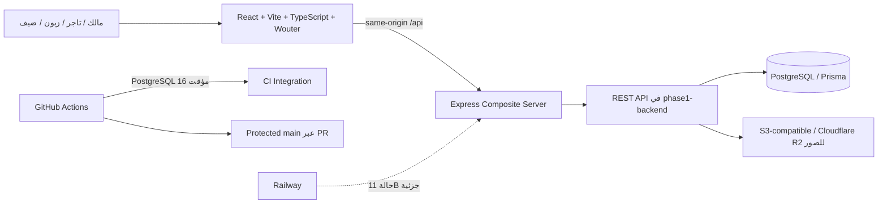

# وثيقة متطلبات البرمجيات (SRS) — منصة CODIQ

**الإصدار:** 1.0  
**الحالة:** خط أساس توثيقي للمراجعة؛ لا يشكل إذناً لتنفيذ أي ميزة.  
**تاريخ المواءمة:** 21 أغسطس 2026.  
**المستودع:** `phsaifaldin/CODIQ`  
**مرجع `main` المتحقق عند الإعداد:** `882b7863bd956e1faff79f6b796108e09b20f644`  
**إعداد الوثيقة:** Manus AI، من الأدلة المتاحة داخل المستودع والتقارير فقط.

> **قاعدة القراءة:** تميّز هذه الوثيقة بين ما هو **منفذ ومختبر**، وما هو **منفذ جزئياً**، وما هو **مخطط فقط**. لا يعني إدراج بند مستقبلي في هذه الوثيقة أنه جاهز أو معتمد للتنفيذ؛ القرار المرحلي الصريح من مالك المشروع يظل شرطاً سابقاً لكل تنفيذ.

---

## 1. الغرض والنطاق

CODIQ منصة SaaS عراقية متعددة المستأجرين لإدارة المتاجر الإلكترونية. تفصل المنصة بنيوياً بين **مالك المنصة** و**التاجر** و**الزبون**، وتبني بيانات المتجر وحساباته وطلباته حول حدود عزل صارمة على مستوى PostgreSQL والخادم. يدعم النظام حالياً إدارة المنتجات والمخزون والطلبات، وStorefront عربي للشراء بالدفع عند الاستلام، وحساب الزبون وسلته وحجز المخزون، وأتمتة CI وحماية فرع `main`. [1] [2] [6] [7] [8]

لا تتضمن النسخة الحالية دفعاً إلكترونياً أو اشتراكات مدفوعة أو تكامل شركة شحن أو رسائل SMS/Email أو موظفين بصلاحيات دقيقة؛ هذه كلها مراحل مستقبلية موثقة بوضوح في الخارطة الرسمية. [1]

| نطاق SRS | الوصف |
|---|---|
| **يشمله** | المتطلبات المثبتة في مراحل 1–11A، وحالة 11B الجزئية، والمتطلبات المخططة للمراحل 12–26. |
| **لا يشمله كتطبيق قائم** | أي ميزة لا تزال ضمن خارطة مستقبلية أو Backlog، حتى إن كانت موصوفة هنا لتفسير الاتجاه المعماري. |
| **نموذج العمل الحالي** | متجر متعدد المستأجرين، طلبات COD، ورسوم توصيل حسب المحافظة، مع قابلية نقل تعتمد PostgreSQL وS3-compatible بدلاً من خصائص مزود مغلقة. |

---

## 2. أصحاب المصلحة والأدوار

| الدور | الهوية والصلاحية | المسؤوليات الوظيفية الحالية |
|---|---|---|
| **مالك المنصة** | حساب وجلسة منفصلان؛ وصول عالمي مصرح به. | إضافة تاجر يدوياً، قراءة المتاجر والمنتجات والطلبات، والإشراف على دورة الطلبات دون صلاحية تغيير حالة الطلب. |
| **التاجر** | حساب وجلسة مقيدة بمتجر واحد في كل جلسة. | إدارة منتجات المتجر وتصنيفاته وصوره ومخزونه، إضافة زبون يدوياً، وإدارة طلبات متجره وفق آلة الحالات. |
| **الزبون** | حساب متجر بالهاتف وكلمة المرور؛ جلسة Cookie محمية. | تصفح كتالوج متجر، إدارة سلة وعناوين، إتمام COD، وعرض طلباته وتاريخها الآمن. |
| **ضيف Storefront** | Cookie ضيف مضبوطة بنطاق API للمتجر. | تصفح وإدارة سلة قبل الدخول؛ تدمج السلة مع حساب الزبون على الخادم عند التسجيل أو الدخول. |
| **منفذ/مراجع تقني** | لا يملك مسار تجاوز للأدوار. | يعمل عبر فرع وPR وفحوصات CI؛ لا يدمج التغييرات من دون موافقة المالك. |

فصل الأدوار ليس واجهة فقط: الحسابات والجلسات والعلاقات تخضع لحدود بيانات وصلاحيات خادمية وقيود قاعدة بيانات. [2] [3] [4]

---

## 3. المبادئ الملزمة ومتطلبات الجودة الأساسية

> «الصحة والأمان قبل السرعة»، و«PostgreSQL قياسي + S3-compatible + أسرار عبر البيئة»، و«إثبات إيجابي وسلبي قبل التسليم» هي مبادئ تشغيلية ملزمة، وليست تفضيلات تصميمية. [2]

| المعرّف | المتطلب غير الوظيفي | معيار القبول/التطبيق |
|---|---|---|
| NFR-01 | **عزل المستأجرين** | كل قراءة أو كتابة متجريّة تقيد بـ`store_id` أو بعلاقة مركبة مكافئة؛ محاولات IDOR ترفض بـ`403` أو`404` وفق العقد. |
| NFR-02 | **قابلية النقل** | PostgreSQL قياسي، Prisma، Express، وتخزين صور S3-compatible؛ لا يفرض منطق الأعمال مزوداً سحابياً محدداً. |
| NFR-03 | **الأسرار** | لا أسرار في Git أو ملفات التطبيق؛ CI لا يستخدم Neon؛ بيئات النشر تحفظ القيم في إعدادات البيئة فقط. |
| NFR-04 | **سلامة التزامن** | عمليات checkout والحجز تستعمل معاملات PostgreSQL وأقفال صفوف وإجراءات idempotency؛ لا يسمح بتجاوز المخزون المتاح. |
| NFR-05 | **تدقيق الحالات** | انتقالات الطلب versioned وappend-only؛ `order_status_events` غير قابل للتعديل أو الحذف عبر Triggers. |
| NFR-06 | **الجوال وRTL** | Storefront عربي، RTL، Mobile-first، واختبر على عرض 390px مع keyboard وARIA وحالات loading/empty/error. |
| NFR-07 | **بوابة التغيير** | فرع لكل مرحلة، PR، CI، تقرير، مراجعة خارجية، وموافقة المالك قبل الدمج. فرع `main` محمي. |

---

## 4. المعمارية المستهدفة والحالة الحالية

### 4.1 المكونات التقنية

الواجهة مبنية بـReact وVite وTypeScript وTailwind، بينما يخدم `server/index.ts` النسخة المركبة: SPA من `dist/public` وREST API تحت `/api`. منطق الأعمال الفعلي موجود في Express/Prisma داخل `phase1-backend`، وليس في قالب tRPC أو OAuth أو StorageProxy. [3] [4] [7]

| الطبقة | التقنية والحالة | المسؤولية |
|---|---|---|
| الواجهة | React، Vite، Wouter، Tailwind v4، RTL. | لوحات المالك والتاجر وStorefront. |
| الخادم | Express + TypeScript + Prisma. | REST، المصادقة، التفويض، المعاملات، حجز المخزون، تسعير التوصيل. |
| البيانات | Neon PostgreSQL؛ هجرات Prisma سبع حتى 9A. | هويات، متاجر، كتالوج، مخزون، طلبات، سلات، حجوزات، rate limits. |
| التخزين | S3-compatible، والموفر المخطط/الموثق هو Cloudflare R2. | صور المنتج كـobject keys وmetadata فقط، لا bytes داخل DB. |
| جودة التغيير | GitHub Actions، PostgreSQL 16 مؤقت، حماية `main`. | فحص وbuild وتكامل قبل الدمج. |
| الاستضافة | Railway مستخدم في 11B جزئياً؛ staging غير مؤكد بعد. | لا يعد ذلك إعلان جاهزية نشر أو إنتاج. |

### 4.2 حدود بيئات التشغيل

| البيئة | الحالة | قاعدة البيانات/الأسرار | سياسة النشر |
|---|---|---|---|
| محلي | مدعوم للاختبارات والتطوير. | اختبار معزول فقط؛ حارس يمنع `TRUNCATE` خارج أسماء test/development/phase. | حر. |
| CI | منفذ ومثبت. | PostgreSQL 16 مؤقت باسم يحوي `test`؛ بلا أسرار Neon أو S3 خارجية. | يعمل على PR وpush إلى main. |
| staging | **غير مؤكد/محجوب في 11B**. | يجب أن يستخدم Neon staging وأسرار staging فقط. | الهدف هو auto-deploy من `main` بعد توثيق البيئة الصحيحة. |
| production | موجود كمفهوم تشغيل Railway ظاهر، لكن لا يجب لمسه ضمن 11B الحالية. | أسرار النشر فقط؛ لا تدخل GitHub أو CI. | يدوي بموافقة صريحة فقط. |

---

## 5. نموذج البيانات ومتطلبات العزل

### 5.1 الكيانات الأساسية

| المجال | الكيانات الرئيسية | قاعدة العزل |
|---|---|---|
| الهوية | `platform_owners`, `merchants`, `customers` وجلسات منفصلة لكل منها. | العميل ينتمي إلى متجر؛ التاجر يملك متاجر؛ المالك عالمي. |
| التجارة | `stores`, `products`, `product_categories`, `product_images`, `inventory_movements`. | `store_id` على جميع البيانات المتجرية؛ SKU والتصنيف فريدان داخل المتجر. |
| الطلبات | `store_orders`, `order_items`, `order_status_events`. | `store_id` وFKs مركبة؛ الأحداث محمية من update/delete. |
| Storefront | `shopping_carts`, `cart_items`, `customer_addresses`, `checkout_requests`, `inventory_reservations`. | FKs مركبة بين `customer_id + store_id` و`order_id + store_id`; keys idempotency خاصة بالمتجر والعميل. |
| الضبط | `delivery_rates`, `payment_methods`, `notification_settings`, `storefront_rate_limits`. | rates وmethods وsettings داخل المتجر؛ rate limit يضم نطاق المتجر ضمن مادة مفتاح التجزئة في الخدمة. |

### 5.2 قيود بنيوية لازمة

تتطلب المنصة علاقات مركبة وقيود uniqueness لمنع الخلط بين المتاجر، وتستخدم Triggers في النقاط التي يجب ألا تعتمد على التطبيق فقط. من الأمثلة: حماية بريد مالك المنصة من أن يسجل كتاجر، عدم قابلية تعديل سجل حالات الطلب، وتطابق `store_id` داخل علاقات الحدث والطلب. [1] [3] [7]

| المعرّف | القيد |
|---|---|
| DBR-01 | لا يملك العميل أكثر من سلة نشطة واحدة في المتجر نفسه. |
| DBR-02 | email/phone للعميل فريدان داخل المتجر فقط؛ يمكن تكرارهما في متجر آخر وفق السياسة المعتمدة. |
| DBR-03 | `order_status_events` append-only وغير قابل للحذف أو التعديل. |
| DBR-04 | `checkout_requests` يمنع تكرار idempotency key لنفس العميل والمتجر. |
| DBR-05 | حجز المنتج والطلب والسلة يتطابقون في `store_id` عبر مفاتيح خارجية مركبة. |

---

## 6. المتطلبات الوظيفية المنفذة

### 6.1 الهوية والتفويض

| المعرّف | المتطلب | الحالة |
|---|---|---|
| FR-IDENT-01 | مالك وتاجر وزبون يملكون حسابات وجلسات منفصلة. | منفذ ومختبر. |
| FR-IDENT-02 | جلسة التاجر مقيدة بمتجر واحد ولا تصل لمتجر آخر حتى للتاجر نفسه. | منفذ ومختبر. |
| FR-IDENT-03 | تسجيل العميل ودخوله للهاتف وكلمة المرور عبر Storefront فقط. | منفذ ومختبر. |
| FR-IDENT-04 | aliases القديمة لمسارات العميل أزيلت نهائياً وتعيد `404`. | منفذ ومختبر. |
| FR-IDENT-05 | الزبون لا يستخدم Bearer token مخزناً في المتصفح؛ جلساته وCookie الضيف HttpOnly ومحدودتان بالمتجر. | منفذ ومختبر. |

### 6.2 إدارة التاجر والكتالوج

| المعرّف | المتطلب | الحالة |
|---|---|---|
| FR-MER-01 | يضيف مالك المنصة تاجراً نشطاً مع متجر أول بمعاملة ذرية. | منفذ ومختبر. |
| FR-MER-02 | يضيف التاجر زبوناً يدوياً لمتجره فقط. | منفذ ومختبر. |
| FR-CAT-01 | ينشئ التاجر تصنيفات ومنتجات خاصة بمتجره. | منفذ ومختبر. |
| FR-CAT-02 | يعدّل ويحذف المنتج والتصنيف ضمن متجره فقط. | منفذ ومختبر ضد IDOR. |
| FR-CAT-03 | يدير المخزون ويحصل على مؤشر low-stock. | منفذ ومختبر. |
| FR-CAT-04 | يرفع صور منتجات إلى تخزين S3-compatible مع فحص محتوى الملف. | منفذ ومختبر. |

### 6.3 دورة حياة الطلبات

آلة الحالات المعتمدة هي:

| الحالة الحالية | الانتقالات المسموحة |
|---|---|
| `new` | `processing`, `cancelled`, `rejected` |
| `processing` | `preparation`, `cancelled` |
| `preparation` | `out_for_delivery`, `cancelled` |
| `out_for_delivery` | `completed`, `returned` |
| `completed` | `returned` |
| `cancelled`, `rejected`, `returned` | نهائية |

| المعرّف | المتطلب | الحالة |
|---|---|---|
| FR-ORD-01 | انتقال حالة الطلب يفرض `expectedVersion` ويعيد `409` عند تعارض النسخة. | منفذ ومختبر. |
| FR-ORD-02 | الانتقال غير المسموح يعيد `422 INVALID_ORDER_TRANSITION`. | منفذ ومختبر. |
| FR-ORD-03 | التاجر يدير طلبات متجره، والمالك يقرأ عالمياً دون تغيير الحالات. | منفذ ومختبر. |
| FR-ORD-04 | تاريخ الحالة آمن للعميل ولا يسرب actor أو internal note أو بيانات تشغيلية. | منفذ ومختبر. |
| FR-ORD-05 | `completed → returned` لا يعيد المخزون تلقائياً؛ يسجل `pending_inspection` حتى قرار المرحلة 17. | منفذ ومعتمد في ADR. |

### 6.4 Storefront والشراء COD

| المعرّف | المتطلب | الحالة |
|---|---|---|
| FR-SF-01 | عرض كتالوج عام، تفاصيل منتج، وصور فعالة لمتجر محدد. | منفذ ومختبر. |
| FR-SF-02 | سلة موحدة للضيف والعميل، مع price snapshot وإصدار version. | منفذ ومختبر. |
| FR-SF-03 | دمج سلة الضيف مع سلة العميل ضمن معاملة خادمية عند التسجيل أو الدخول. | منفذ ومختبر. |
| FR-SF-04 | checkout COD يتطلب جلسة عميل؛ guest checkout المباشر يرفض بـ`401 CUSTOMER_SESSION_REQUIRED`. | منفذ ومعتمد كقرار دائم. |
| FR-SF-05 | checkout idempotent؛ إعادة المفتاح والـpayload نفسه تعيد الطلب نفسه، والـpayload المختلف يرفض بـ`409 IDEMPOTENCY_KEY_REUSED`. | منفذ ومختبر. |
| FR-SF-06 | لا يسمح checkout بحجز يتجاوز المخزون المتاح؛ منافسة آخر قطعة تنتج نجاحاً واحداً ورفضاً واضحاً للثاني. | منفذ ومختبر. |
| FR-SF-07 | المنتج غير النشط أثناء checkout يرفض بـ`422 PRODUCT_UNAVAILABLE` بلا order أو reservation أو تعديل مخزون. | منفذ ومختبر حتمياً. |
| FR-SF-08 | عنوان عميل آخر أو طلب عميل آخر لا يقرأ ولا يستخدم في checkout. | منفذ ومختبر بـ`404`. |
| FR-SF-09 | رسوم التوصيل تؤخذ من `delivery_rates` للمتجر والمحافظة داخل المعاملة نفسها، وتلتقط على الطلب. | منفذ ومختبر. |
| FR-SF-10 | محافظة بلا rate مفعل ترفض بـ`422 DELIVERY_UNAVAILABLE_FOR_GOVERNORATE`. | منفذ ومختبر. |
| FR-SF-11 | واجهة checkout تعرض subtotal، delivery fee، total، ورسالة عربية مفهومة عند رفض المحافظة. | منفذ ومختبر. |
| FR-SF-12 | صفحات طلبات العميل تستخدم cursor pagination وتعزل العميل والمتجر. | منفذ ومختبر. |

### 6.5 مسارات API الرئيسية

تُركب كل المسارات أدناه تحت `/api` في الخادم المركب. هذه ليست وثيقة OpenAPI كاملة؛ التوثيق الآلي OpenAPI مخطط للمرحلة 20. [4] [1]

| المجال | أمثلة المسارات العامة |
|---|---|
| الصحة | `GET /api/health` → `{ status: "ok", env }`، بلا auth أو middleware سابق. |
| Storefront عام | `GET /api/store/:storeSlug/products`، `GET /api/store/:storeSlug/products/:productId`. |
| السلة | `GET/POST /api/store/:storeSlug/cart` و`/cart/items`. |
| حساب الزبون | `/api/store/:storeSlug/account/register`, `/login`, `/logout`, `/account`, `/addresses`, `/orders`. |
| checkout والتوصيل | `GET /api/store/:storeSlug/account/addresses/:addressId/delivery-quote` و`POST /api/store/:storeSlug/checkout`. |
| التاجر | `/api/merchant/stores/:storeSlug/catalog/*` و`/orders/*` و`/customers/manual`. |
| المالك | `/api/platform/merchants/manual`, `/platform/orders/*`, ومسارات القراءة والإشراف. |

---

## 7. واجهات الاستخدام والتنقل

| الواجهة | الحالة | ملاحظات SRS |
|---|---|---|
| لوحة المالك | موجودة بهوية One UI وRTL. | الصفحة الرئيسية الهيكلية ما زالت Placeholder مقصوداً؛ B-13 وB-14 يحددان جعل navigation readiness وجلسة الواجهة أدق في المرحلة 14. |
| لوحة التاجر | موجودة بهوية One UI وسياق متجر واحد. | إدارة المنتجات والطلبات تعمل؛ Store Switcher متعدد المتاجر مخطط للمرحلة 13. |
| Storefront | منفذ بالعربية: كتالوج، منتج، سلة، حساب، checkout، طلبات. | نجحت UI-01 إلى UI-07 على بيئة development المعزولة. |
| الوصول | مسارات الدور مستقلة. | التفويض النهائي دائماً على الخادم، لا على إخفاء عناصر الواجهة. |

---

## 8. الأمن والاختبار

### 8.1 ضوابط أمنية منفذة

| المجال | الضابط |
|---|---|
| الجلسات | Hash tokens في القاعدة، Cookies HttpOnly، وscoping لمسارات Storefront. |
| الطلبات الكتابية | trusted Origin وrate limits لـStorefront وidempotency للـcheckout. |
| IDOR | فحص role + ownership + store scope في API والاستعلامات؛ اختبارات سالبة للأوامر والعناوين والمنتجات والمتاجر. |
| قاعدة البيانات | Triggers وFKs مركبة وuniques تحمي العزل حتى ضد SQL المباشر في النقاط المحددة. |
| المخزون | Serializable + row-level locks + reservations؛ عدم oversell مثبت باختبارات منافسة. |
| رفع الصور | multipart وفحص magic bytes؛ حدود ملفات الصور ليست JSON. |
| أسرار الاختبار | حارس يرفض `TRUNCATE` عند عنوان إنتاجي أو غير موسوم test/development/phase. |

### 8.2 مصفوفة الاختبار الحالية

| طبقة الاختبار | التغطية المثبتة |
|---|---|
| التكامل الخلفي | الهوية، tenancy، provisioning، الكتالوج، دورة الطلبات، Storefront، الحجز، IDOR، concurrency. |
| المتصفح | المرحلة 6 و7 و8B و9B محلياً؛ UI-01 حتى UI-07 وmobile/RTL/accessibility في 9B. |
| الوصول وقيود DB | SQLSTATE، Triggers، FKs مركبة، ورفض المسارات غير المصرح بها. |
| الخادم المركب | API وSPA، وحد JSON 1mb، ورفض منفذ مشغول بـEADDRINUSE. |
| CI | تكامل حاجب على PostgreSQL 16 مؤقت؛ وظيفة browser acceptance ظاهرة وغير حاجبة بسبب B-15. |

---

## 9. التسليم، CI، وحوكمة Git

| المعرّف | المتطلب | الحالة |
|---|---|---|
| OPS-01 | كل تغيير يمر بفرع ثم PR. | منفذ وملزم على `main`. |
| OPS-02 | `ci / integration` ينفذ typecheck وbuild وmigrations واختبارات التكامل على PostgreSQL 16 مؤقت. | منفذ ومثبت. |
| OPS-03 | CI لا يستخدم Neon أو أسرار production. | منفذ ومثبت. |
| OPS-04 | `main` يتطلب PR ونجاح `ci / integration`، ويشمل المسؤولين ويمنع force-push والحذف. | منفذ ومثبت برسالة `GH006`. |
| OPS-05 | اختبارات المتصفح تصبح حاجبة فقط بعد تشغيلات CI مستقرة وقرار مالك صريح. | مؤجل؛ B-15. |
| OPS-06 | staging ينشر تلقائياً من main، بينما production ترقية يدوية. | هدف 11B؛ **غير مثبت بعد**. |

---

## 10. خطة التنفيذ الرسمية 1–26

### 10.1 حالة المراحل المنجزة أو الجارية

| المرحلة | الاسم | الحالة العملية الحالية |
|---:|---|---|
| 1 | أساس الهوية والعزل | مكتملة ومختبرة. |
| 2 | هيكل لوحة المالك | مكتملة؛ الصفحة الرئيسية Placeholder مقصود. |
| 3 | هيكل لوحة التاجر | مكتملة. |
| 4 | بوابة الفصل الكامل | مكتملة مع إعادة اختبار. |
| 5 | عزل التجار ببيانات حية | مكتملة ومختبرة. |
| 6 | الإضافة اليدوية للتاجر/الزبون | مكتملة ومختبرة. |
| 7 | إدارة المنتجات الحقيقية | مكتملة ومختبرة. |
| 8 | دورة حياة الطلبات (8A + 8B) | مكتملة ومختبرة. |
| 9 | خلفية Storefront 9A ثم واجهة 9B | مكتملة وظيفياً ومختبرة؛ سجلت التحسينات اللاحقة في 10. |
| 10 | تصلب 9A وتنظيف الإرث | مكتملة ومندمجة. |
| 11A | CI/CD وحماية main | مكتملة ومندمجة. |
| 11B | Railway staging | **قيد التنفيذ/محجوبة**: `/api/health` و`postinstall` اندمجا، لكن staging المنفصلة وPublic Domain لم يتأكدا؛ النشر المرئي موسوم production فقط. |

### 10.2 خارطة المتطلبات المستقبلية

| المرحلة | المتطلب المركزي | قرار مالك مطلوب قبل التنفيذ |
|---:|---|---|
| 12 | تطوير/تعزيز Storefront وحساب الزبون وفق الخطة الرسمية: كتالوج وسلة وCOD وعناوين وتجربة RTL/mobile وSEO الأساسي. | اعتماد سيناريوهات قبول المتصفح. |
| 13 | Store Switcher وإنشاء متجر جديد للتاجر مع حد مؤقت. | الحد المؤقت للمتاجر. |
| 14 | Staff، RBAC granular، وNavigation مركزي. | ADR نموذج staff وقائمة الصلاحيات والأدوار. |
| 15 | Outbox وإشعارات email/SMS. | مزود الرسائل الأول. |
| 16 | plans/subscriptions وFeature Gating خادمي. | الخطط والحدود والأسعار. |
| 17 | التسويات والعمولات والنطاقات والتسجيل الذاتي للتاجر. | نافذة الإرجاع ونسب العمولة وسياسة التسجيل. |
| 18 | تدقيق معماري شامل وسجل دين تقني. | اعتماد ترتيب الأولويات. |
| 19 | اختبار أمان وعزل فعلي وOWASP/ASVS. | لا Critical مفتوح للانتقال. |
| 20 | تدقيق البيانات والـAPI وOpenAPI وsearch. | اعتماد عقود API v1. |
| 21 | بنية أمامية وDesign System وtheme للمتجر. | مراجعة B-12 وترتيب refactor. |
| 22 | i18n وWCAG وSEO شامل. | اللغات وسياسة الفهرسة. |
| 23 | الأداء والحمل وقياسات p50/p95/p99. | budgets وأهداف الحمل. |
| 24 | التشغيل والمراقبة والنسخ والاستعادة. | مزودات observability وخطة RPO/RTO. |
| 25 | الدفع الإلكتروني والتوصيل والفوترة الكاملة. | بوابة الدفع وشركة التوصيل. |
| 26 | التوثيق والتدقيق النهائي وإعلان الجاهزية. | قبول final production audit. |

> **ملاحظة اتساق:** الواقع الحالي يتضمن Storefront 9B منجزاً ومختبراً قبل اعتماد خارطة v2 التي تسمي Storefront مرحلة 12. لا يعاد تنفيذ ما هو موجود؛ يجب أن تعيد مواصفة المرحلة 12 تعريف نطاقها بوصفه تعزيزاً أو إغلاقاً للفجوات المتبقية وفق حالة الكود والاختبارات، لا تكراراً ميكانيكياً للواجهة. [1] [6]

---

## 11. الديون والمخاطر والقرارات المعلقة

| الأولوية | البند | الأثر | المعالجة/المرحلة |
|---|---|---|---|
| عالية | Railway staging غير مؤكدة، والنشر المرئي ظهر تحت production فقط. | لا يمكن اعتماد 11B أو فحص health على staging بأمان. | تأكيد بيئة staging وPublic Domain قبل أي فحص/تغيير إضافي. |
| عالية | B-15: اختبارات المتصفح غير مستقرة في GitHub Runner. | ليست فحصاً حاجباً في CI رغم نجاحها محلياً. | تشغيلات خضراء متكررة ثم قرار صريح لجعلها حاجبة. |
| متوسطة | bundle JavaScript فوق حد تحذير Vite 500kB. | أثر أداء محتمل، لا خلل وظيفي مثبت. | المرحلة 21 أو 23. |
| متوسطة | `tar` غير المباشر من `@tailwindcss/oxide`. | تحذير dependency معروف؛ لا ترقية عشوائية. | B-12، المرحلة 21. |
| متوسطة | لوحة المالك/التاجر تحتاج readiness matrix وguard هوية واجهة. | قد تخلط placeholder بميزة منجزة أو تعرض تسمية ثابتة. | B-13 وB-14، المرحلة 14. |
| متوسطة | return policy المالية. | لا تسوية مالية كاملة للمرتجعات بعد. | ADR-001 والمرحلة 17. |
| منخفضة حالياً | OpenAPI وAPI versioning. | التوسع الخارجي يحتاج عقداً مولداً. | المرحلة 20. |

---

## 12. معايير القبول العامة لكل مرحلة قادمة

لا تغلق مرحلة قادمة ما لم يتحقق الآتي، إضافة إلى معاييرها الخاصة:

1. يوجد فرع عمل وPR واضحان، ولا يوجد دفع مباشر إلى `main`.
2. ينجح `ci / integration` الحاجب، وتشمل النتيجة typecheck وbuild واختبارات التكامل على قاعدة مؤقتة.
3. تنفذ اختبارات المرحلة الإيجابية والسلبية، بما فيها IDOR والتزامن إن مسّت بيانات متجر أو مخزون أو جلسة.
4. تكتب وثيقة تقرير تحدد الملفات والـAPI والهجرات والاختبارات والقرارات والمخاطر، من دون أسرار.
5. تمر مراجعة المالك وموافقته الصريحة قبل الدمج؛ لا تعالج فكرة إضافية أو ديناً خارج النطاق من دون قرار منفصل.
6. لا تلمس production أو تنفذ migration تدميرية أو `TRUNCATE` على قاعدة غير معزولة.

---

## 13. المراجع الداخلية

[1]: [الخطة الكاملة للمراحل 1–26](../docs/CODIQ_FULL_PLAN_26_PHASES.md)  
[2]: [مبادئ CODIQ الهندسية](../PROJECT_ENGINEERING_PRINCIPLES.md)  
[3]: [مخطط Prisma والهجرات](../prisma/schema.prisma)  
[4]: [عقود Express وREST](../phase1-backend/src/http/app.ts)  
[5]: [منطق Storefront والمعاملات](../phase1-backend/src/services/storefront.service.ts)  
[6]: [تقرير المرحلة 9B](PHASE9B_REPORT.md)  
[7]: [تقرير المرحلة 10](PHASE10_REPORT.md)  
[8]: [تقرير المرحلة 11A](PHASE11A_REPORT.md)  
[9]: [مسار النشر والبيئات](../docs/DEPLOYMENT.md)  
[10]: [سجل Backlog](../docs/BACKLOG.md)  
[11]: [نتائج الوصول إلى Railway في 11B](RAILWAY_ACCESS_FINDINGS.md)
